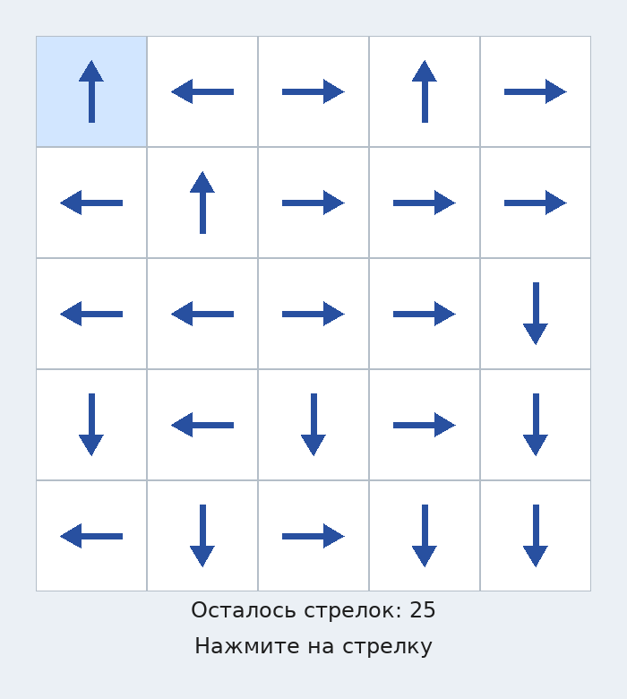
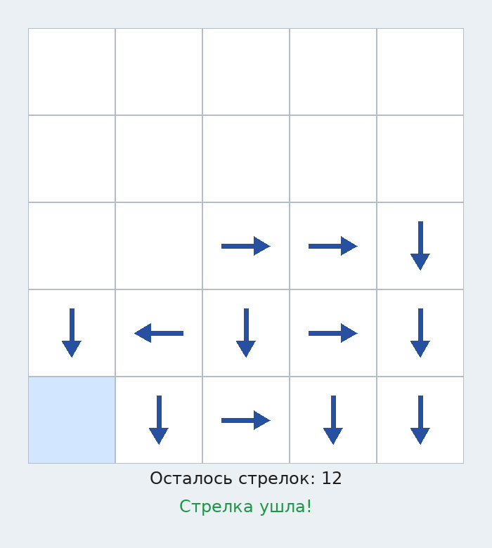

# ➡️ «Стрелки» — головоломка на pygame


Учебный проект с курса **[«Python: от стрелок до ООП»](https://stepik.org/course/297691)** (Людмила Колесникова, Stepik): головоломка «Стрелки», прошедшая путь от консольного прототипа в одном файле до GUI-игры на pygame с модульной архитектурой, машиной состояний и тестами.

---

## 🎮 Правила

<p align="center">
  
</p>

На поле N×N в каждой клетке — стрелка, указывающая в одну из четырёх сторон.

- **Убрать стрелку можно, только если на её пути до края поля нет других стрелок**;
- цель — очистить поле полностью;
- генератор поля всегда создаёт **решаемую** расстановку (взаимные «блокировки» исключены конструкцией генерации от центра поля).

| Управление | Действие |
|---|---|
| **цифры / Backspace** | ввод размера поля на стартовом экране |
| **Enter** | начать игру (или новую после победы) |
| **ЛКМ** по стрелке | убрать (если путь свободен) |
| **R** | новая игра |

Игра живёт в трёх экранах: **стартовый ввод размера → поле → экран победы** с возможностью сразу начать заново с новым размером. Подсказки под полем: счётчик оставшихся стрелок и сообщение о результате хода (зелёное — успех, красное — ошибка). Клетка под курсором подсвечивается.

<details>
<summary>Скриншот середины игры</summary>


</details>

---

## 🧠 Эволюция проекта

Проект сознательно сохраняет историю «как код становится программой» — четыре этапа:

| Этап | Файлы | Что появилось |
|---|---|---|
| 1. Консольный прототип | [`legacy/arrow_puzzle.py`](legacy/arrow_puzzle.py) | функции, глобальная `SIZE`, ввод `row col direction` из консоли |
| 2. Рефакторинг кода из курса + оптимизация | [`legacy/arrow_puzzle_fixed.py`](legacy/arrow_puzzle_fixed.py) | размер поля параметром, `mid = (size - 1) / 2` — генерация любых размеров |
| 3. Модульная версия + OOP + GUI | `direction.py`, `field.py`, `game.py`, `ui.py`, `main.py` | классы по ответственности, enum направлений, pygame-рендер |
| 4. Экраны и машина состояний | те же модули + `tests/` | `input → playing → game_over`, `TextInput` с валидацией, чистая функция `resolve_click()` |

Историю шагов подробно видно в коммитах: `added class Field` → `added enum - directions` → `refactored code in separated files` → `rewrited using pygame` → `added endscreen and graphic size screen`.

## 📐 Как устроен код

| Модуль | Ответственность |
|---|---|
| `direction.py` | `Direction` — enum: вектор смещения `(dr, dc)`, юникод-символ, `apply(cell)` и парсинг `from_string()` |
| `field.py` | `Field` — чистая игровая логика: генерация решаемого поля, `make_move()` с тремя проверками (клетка, направление, путь) |
| `ui.py` | `FieldRenderer` — отрисовка поля (сетка, hover-подсветка, стрелки полигонами); `TextInput` — поле ввода цифр с мигающим курсором |
| `game.py` | `Game` — машина состояний и цикл событий; `resolve_click()` — чистая функция «клик → сообщение и цвет», не зависящая от pygame |
| `main.py` | точка входа |
| `tests/` | pytest: решаемость генератора, валидация ходов, фильтр ввода, полный жизненный цикл — всё в headless-режиме |

**Нюансы реализации:**
- путь проверяется «лучом» от клетки до края — `path_is_clear()`;
- стрелки рисуются не шрифтом, а полигонами — масштабируются под любой размер клетки;
- игровая логика (`Field`, `resolve_click`) не знает про pygame — GUI и тесты делят один и тот же код, это и есть выгода от разделения ответственности.

---

## 🚀 Запуск

**Требования:** Python 3.13+, [uv](https://docs.astral.sh/uv/).

```bash
git clone https://github.com/Ibndaud/console-game-arrows-in-python.git
cd console-game-arrows-in-python

uv sync
uv run python main.py
```

<details>
<summary>Без uv (pip + venv)</summary>

```bash
python -m venv .venv
source .venv/bin/activate      # Windows: .venv\Scripts\activate
pip install pygame
python main.py
```
</details>

Размер поля вводится на стартовом экране (по умолчанию допускается 1..30).

## 🛠 Разработка

```bash
uvx ruff check .     # линтер — те же проверки, что в CI
uv run pytest -q     # тесты (headless, окно не открывается)
```

CI (`.github/workflows/ci.yml`) на каждый push и pull request:
- **линтинг** — ruff;
- **smoke-тесты** — компиляция и headless-импорт модулей;
- **тесты** — pytest.

## 📄 Лицензия

[MIT](LICENSE.txt)
